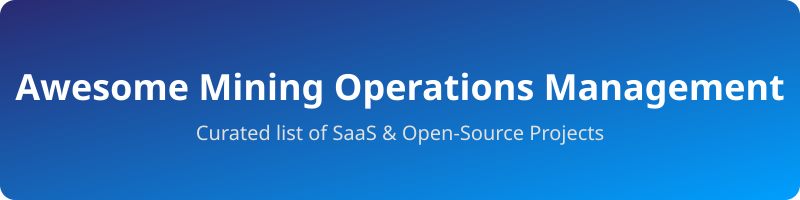

<!-- SEO: Mining Software, SaaS, Open Source Mining, Fleet Management, Geological Modelling, Mining Operations Management -->

 

<!-- SEO: Mining Software, SaaS, Open Source Mining, Fleet Management, Geological Modelling, Mining Operations Management -->

 

 

# ⛏️ Awesome-Mining-Operations-Management

## 🌍 Top Mining Operations Management Tools Ecosystem

**Curated List of SaaS Products & Open-Source GitHub Projects**

*Focused on Mine Planning, Geological Modelling, Fleet Management, Resource Estimation, Scheduling & Operational Intelligence*

**Last updated: July 2026**

This repository tracks notable **SaaS platforms** and **open-source projects** for **Mining Operations Management**. These tools support the full mining value chain — from exploration and geological modelling through mine design, scheduling, fleet management, grade control, and production optimisation.

**Examples** include Hexagon Mining, MineRP, RPMGlobal, Micromine, Deswik, Datamine, Maptek, MineSense, GroundHog, Minemax, Seequent, GEOVIA, EarthSoft (the category leaders).

**Open-source emphasis**: This section is heavily expanded with every major active project for self-hosting, custom sensor integration, geological modelling, geostatistics, and open mining data processing — ideal for mining companies, researchers, consultants, and developers building transparent, auditable mining solutions.

Contributions welcome! Open a PR to add/update entries. Keep descriptions factual and link to official sites.

## 📑 Table of Contents

- [SaaS/Hosted Platforms](#saas-hosted-platforms)
- [Open-Source GitHub Projects](#open-source-github-projects)
- [How to Contribute](#how-to-contribute)
- [Disclaimer](#disclaimer)

## ☁️ SaaS/Hosted Platforms

| Product | Description | Pricing | Company Size (Rev/Val) |
| :--- | :--- | :--- | :--- |
| **[Deswik (Sandvik)](https://www.deswik.com/)** | Comprehensive CAD, design, scheduling, and operational planning platform (Spatial, Planning, OPS, GO) for open-pit and underground mines. | Contact for Pricing | ~$12B |
| **[GEOVIA (Dassault Systèmes)](https://www.3ds.com/products/geovia)** | Geology modelling, pit optimisation (Whittle), scheduling (MineSched), and collaborative mine planning on the 3DEXPERIENCE platform (Surpac and related roles). | Contact for Pricing | ~$6.5B |
| **[MineRP (Powered by Epiroc)](https://www.epiroc.com)** | Open OT platform unifying technical mining data with ERP systems; includes Enterprise Production Scheduler and short-interval control for open-pit and underground operations. | Contact for Pricing | ~$6B |
| **[Hexagon Mining](https://hexagon.com/products/product-groups/mining)** | Integrated life-of-mine solutions covering mine planning (HxGN MinePlan), fleet management (OP Pro / UG Pro), drill & blast, survey, monitoring, and collision avoidance. | Contact for Pricing | ~$5B |
| **[Seequent (Bentley)](https://www.seequent.com/)** | Implicit geological modelling and resource estimation (Leapfrog Geo & Edge), data management (Central, MX Deposit), and geoscience collaboration platform (Evo). | Contact for Pricing | ~$1B |
| **[Datamine](https://dataminesoftware.com/)** | Connected suite for geology, resource modelling, strategic & detailed planning, production, and laboratory management across the mining value chain. | Contact for Pricing | ~$200M |
| **[RPMGlobal](https://rpmglobal.com/)** | Enterprise mining software suite spanning strategic & tactical scheduling (MinePlanner, XECUTE), simulation (HAULSIM), asset maintenance (AMT), and cost modelling. | Contact for Pricing | ~$150M |
| **[Maptek](https://www.maptek.com/)** | 3D mine planning and geological modelling (Vulcan), scheduling (Evolution), laser scanning/survey (PointStudio), and drill & blast (BlastLogic). | Contact for Pricing | ~$120M |
| **[Micromine](https://www.micromine.com/)** | End-to-end ecosystem for exploration, geological modelling (Origin), mine design & planning (Beyond, Alastri, Spry, Advance), and production control (Pitram). | Contact for Pricing | ~$100M |
| **[MineSense](https://minesense.com/)** | Real-time sensor-based ore characterisation and sorting (ShovelSense) for grade control, dilution reduction, and smart truck routing at the face. | Contact for Pricing | ~$50M |
| **[Minemax](https://www.minemax.com/)** (now part of Datamine) | Strategic mine schedule optimisation (Minemax Scheduler) and detailed open-pit planning (Tempo) focused on NPV maximisation. | Contact for Pricing | ~$25M |
| **[GroundHog](https://groundhogapps.com/)** | AI-powered mining operations platform for short-interval control, fleet management, maintenance, safety, and real-time location systems. | Contact for Pricing | ~$20M |
| **[EarthSoft](https://earthsoft.com/)** | EQuIS environmental data management platform widely used by mining companies for water quality, compliance, sustainability reporting, and regulatory workflows. | Contact for Pricing | ~$15M |

## 🔓 Open-Source GitHub Projects

- **[GemPy](https://github.com/gempy-project/gempy)** 
  Open-source Python library for implicit 3D structural geological modelling of complex folded structures, fault networks, and unconformities, with strong support for probabilistic/uncertainty modelling.

- **[GeostatsPy](https://github.com/GeostatsGuy/GeostatsPy)** 
  Open-source Python reimplementation of classic GSLIB geostatistical algorithms for spatial data analysis, estimation, and simulation — excellent for teaching and prototyping.

- **[LoopStructural](https://github.com/Loop3D/LoopStructural)** 
  Open-source 3D structural geological modelling library supporting multiple interpolation schemes, fault networks, fold modelling, and time-aware geological feature construction.

- **[PyGSLIB](https://github.com/opengeostat/pygslib)** 
  Python package for mineral resource estimation and geostatistics (GSLIB-based), including drillhole compositing/desurveying, block modelling, kriging, and validation workflows.

- **[MiningPy](https://github.com/miningpy/miningpy)** 
  Python tools for mining engineering: block model manipulation, reblocking, haulage modelling, interfacing with commercial packages, and visualisation.

- **[Albion](https://gitlab.com/Oslandia/albion)**
  Open-source 3D geological model reconstruction from boreholes built on QGIS, using Delaunay triangulation for rapid correlation and volume modelling.

- **[Baselode](https://github.com/darkmine-oss/baselode)** 
  Open-source multi-language (Python + JavaScript/React) toolkit for mineral exploration and mining focused on drillhole and spatial data processing, management, and visualisation.

- **[Mining-Gym](https://github.com/CBCodeHub/Mining-Gym)** 
  Configurable OpenAI Gym-compatible environment for reinforcement-learning research on truck dispatch and haulage scheduling in open-pit mines.

- **[Open Pit Scheduling (PuLP/CBC)](https://zenodo.org/records/17170962)**
  Transparent Python optimisation framework for open-pit mine production scheduling using linear programming (PuLP + CBC), incorporating economic, geotechnical, and environmental constraints.

- **[QGIS + Mining Plugins](https://plugins.qgis.org/plugins/tags/mining/)**
  Ecosystem of open-source QGIS plugins for drillhole visualisation (e.g. OpenLog), mineral exploration data services, implicit modelling experiments, and geospatial mining workflows.

### 🔧 Additional Strong Open-Source Options

- **Geostatistics & Resource Estimation**: PyGSLIB, GeostatsPy, gstlearn, Geone, and related scientific Python/R libraries.
- **3D Geological Modelling**: GemPy, LoopStructural, ArchPy, ForGEO (QGIS), and Albion.
- **Block Model & Planning Utilities**: MiningPy, open pit optimisers built on igraph / PyMaxflow, and custom PuLP/OR-Tools scheduling notebooks.
- **Visualisation & Data Platforms**: ParaView, CloudCompare, PyVista, and QGIS-centric drillhole/3D viewers.
- **Operations & Simulation Research**: Mining-Gym (RL for fleet dispatch), various discrete-event and optimisation prototypes on GitHub.
- **Environmental & Compliance**: Community tools built around open geospatial standards that complement platforms like EQuIS.

**Frameworks for building custom systems**: Combine **GemPy / LoopStructural** + **PyGSLIB / GeostatsPy** + **MiningPy** + **QGIS** + **InfluxDB / Grafana / Node-RED** + **Ollama / LangGraph** for intelligent, self-hosted geological modelling, resource estimation, and operations intelligence platforms.

## 🤝 How to Contribute

1. Fork the repo.
2. Add/edit entries in `README.md` (follow existing format).
3. Include: name, link, 1–2 sentence description, and whether it's SaaS or open-source.
4. Submit PR with a short explanation.

Star the repo if you find it useful!

## ⚠️ Disclaimer

- This is a **community-curated** list — not exhaustive and not an endorsement.
- Mining software must comply with relevant industry standards, resource reporting codes (JORC, NI 43-101, etc.), safety, and environmental regulations.
- Self-hosted open-source solutions require proper validation, security hardening, and reliability engineering before production use in operating mines.

---

**Made for mining engineers, geologists, mine planners, consultants, researchers, and mining technologists.**

Let's make mining operations management more open, data-driven, and efficient.

## 📈 Star History

<a href="https://www.star-history.com/?repos=ishandutta2007/Awesome-Mining-Operations-Management&type=date&legend=bottom-right">
<picture>
<source media="(prefers-color-scheme: dark)" srcset="https://api.star-history.com/chart?repos=ishandutta2007/Awesome-Mining-Operations-Management&type=date&theme=dark&legend=bottom-right" />
<source media="(prefers-color-scheme: light)" srcset="https://api.star-history.com/chart?repos=ishandutta2007/Awesome-Mining-Operations-Management&type=date&legend=bottom-right" />

</picture>
</a>

## 📈 Star History

<a href="https://www.star-history.com/?repos=ishandutta2007/Awesome-Mining-Operations-Management&type=date&legend=bottom-right">
<picture>
<source media="(prefers-color-scheme: dark)" srcset="https://api.star-history.com/chart?repos=ishandutta2007/Awesome-Mining-Operations-Management&type=date&theme=dark&legend=bottom-right" />
<source media="(prefers-color-scheme: light)" srcset="https://api.star-history.com/chart?repos=ishandutta2007/Awesome-Mining-Operations-Management&type=date&legend=bottom-right" />

</picture>
</a>

