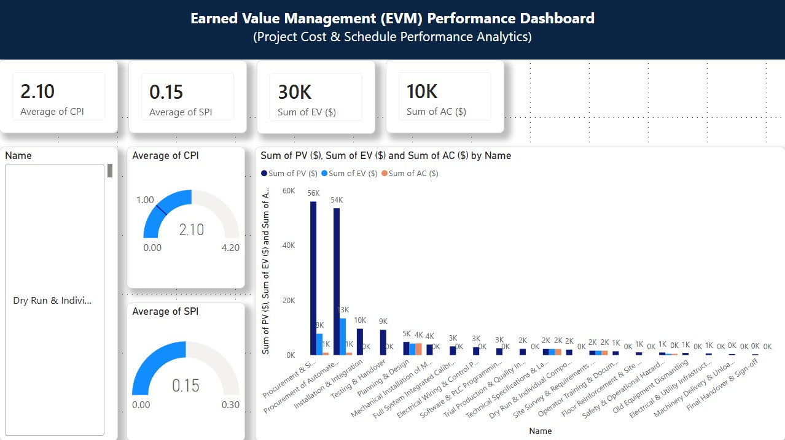

# Earned Value Management (EVM) Performance Analytics & Dashboard

An end-to-end data processing and executive reporting project for tracking Project Cost and Schedule Performance. This repository demonstrates automated EVM calculation using Python and interactive data visualization using Power BI integrated with Microsoft Project.

## Project Overview
In project management and project controls, monitoring planned progress against actual costs and performance is critical. This project extracts schedule data exported from Microsoft Project, cleanses and processes core EVM metrics via a custom Python script, and generates an executive-level interactive dashboard in Power BI.

## Tech Stack & Tools
- Python 3.14: Data extraction, data type handling, and automated EVM metric computations (openpyxl).
- Power BI Desktop: Data modeling, KPI metrics, interactive slicers, and executive dashboard design.
- Microsoft Project: Source baseline schedule and actual cost data generation.

## Calculated EVM Metrics
The Python script (main.py) processes raw task data and calculates the following core Earned Value metrics automatically:
- Planned Value (PV) = Baseline Cost
- Earned Value (EV) = Baseline Cost * % Complete
- Actual Cost (AC) = Actual Cost spent
- Cost Variance (CV) = EV - AC
- Schedule Variance (SV) = EV - PV
- Cost Performance Index (CPI) = EV / AC
- Schedule Performance Index (SPI) = EV / PV

## Executive Dashboard

### Key Features:
- KPI Summary Cards: Real-time evaluation of Total EV, Total AC, Average CPI, and Average SPI.
- Performance Gauges: Visual target tracking for CPI and SPI against the standard project baseline (1.0).
- Cost Comparison Visual: Clustered Column Chart comparing PV, EV, and AC across all project WBS tasks.
- Interactive Filtering: Dynamic Slicer for granular task-level analysis.

## Repository Structure
EVM_Project/
├── Project_Schedule_EVM.mpp        # Source MS Project Schedule
├── msp_export.xlsx                # Raw Excel export from MSP
├── main.py                        # Python EVM calculation script
├── evm_processed_data.xlsx        # Output Excel with processed metrics
├── EVM_Performance_Dashboard.pbix # Power BI Dashboard file
├── dashboard_screenshot.png       # Dashboard preview screenshot
└── README.md                      # Repository documentation

## How to Run the Project

1. Clone the repository:
   git clone https://github.com/ParsaA17/EVM_Project.git
   cd EVM_Project

2. Run the Python script to process raw data:
   python main.py

3. Explore the Power BI Dashboard:
   - Open EVM_Performance_Dashboard.pbix in Power BI Desktop.
   - Click Refresh on the Home tab to load updated data.
